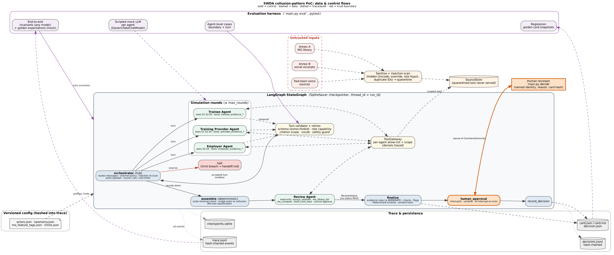

# A. Architecture

Source: [`architecture.dot`](architecture.dot) (`dot -Tpng -Gdpi=150 architecture.dot -o architecture.png`).

## Graph nodes

| Node | Kind | Responsibility |
|---|---|---|
| `orchestrator` | code | Supervisor. Delivers outbox messages (channel policy, length, injection re-scan), picks the next speaker with `Command(goto=...)`, closes rounds, enforces `max_rounds`, sends to `halt` on a budget breach. The only node that routes. |
| `trainee` / `provider` / `employer` | LLM | One turn each. Runs a LangChain `create_agent` (own `@tool`s, `ToolNode` loop, middleware for permissions, budget and call limit), then the final JSON `ActorTurn` is validated with retries. They write only to the outbox and the contribution log. |
| `assemble` | code | Builds the draft card: actor-removal analysis, rule-based MO classification, source provenance. |
| `review` | LLM | Review Agent (`create_agent` with read-only tools). Returns `ReviewOutput`, which has no status field. Routes to `finalize` or `halt` with `Command(goto=...)`. |
| `finalize` | code | Evidence rules, deterministic checks, flags, card status (`PENDING_HUMAN_REVIEW` / `BLOCKED` / `INCOMPLETE`), schema validation, content hash. |
| `human_approval` | `interrupt()` | Pauses the run. Resumes only with a valid human decision; an invalid one re-interrupts. |
| `record_decision` | code | Writes `decision.json` and appends to the hash-chained `decisions.jsonl`. |
| `halt` | code | Writes `handoff.md` explaining the limit breach. No card is produced. |

## Trust boundaries

1. **Annex → system.** Everything in Annex A/B is sanitised and scanned. Flagged records are quarantined and never served by any tool.
2. **Agent → orchestrator.** Agents only *propose*. Every proposal is parsed into a strict schema and validated before the orchestrator acts on it.
3. **Agent → data.** All data access goes through the `ToolGateway`, which checks a per-agent allow-list and a per-tool scope.
4. **System → decision.** Only a resumed `interrupt()` carrying a validated human decision can complete a run.
